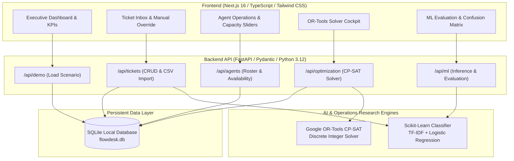

# FlowDesk AI — Enterprise Service-Management & Mathematical Operations Platform

**FlowDesk AI** is an intelligent enterprise service-management MVP designed for IT consulting, banking, insurance, telecom, and enterprise operations. It couples **real machine learning text classification** (Scikit-learn TF-IDF + Logistic Regression) with **exact operations research discrete optimization** (Google OR-Tools CP-SAT) to categorize support tickets and solve complex employee assignment schedules in milliseconds.

## Recruiter demo (3 minutes)

1. Start both services, then open http://localhost:8000/docs and execute `POST /api/demo/load`. This replaces the local demo database.
2. Open http://localhost:3000 and inspect the ticket backlog, predicted categories, and confidence scores.
3. Change Tariq's availability from Busy to Available in Agent Roster; rerun optimization and compare assignment counts and backlog explanations.
4. Show the ML evaluation view and explain that its held-out examples are synthetic, not a production benchmark.

**Scope:** Local portfolio/PFE prototype using synthetic data. Authentication, multi-user isolation, and production deployment hardening are outside this demo. Run one project at a time: both use ports 3000 and 8000. Commands below assume the project root unless otherwise stated.


---

## 1. System Architecture



---

## 2. Real Machine Learning Classification Engine

### Model Architecture
- **Feature Extraction**: Scikit-Learn `TfidfVectorizer` (unigrams + bigrams, sublinear term-frequency scaling).
- **Classification**: Multinomial `LogisticRegression` (L-BFGS solver).
- **Dataset**: 200 labeled demonstration tickets across 5 enterprise categories:
  1. `Technical Support`
  2. `Billing`
  3. `Account Management`
  4. `Service Request`
  5. `General Inquiry`

### Evaluation Performance (Stratified 80/20 Test Split)
Evaluated on a held-out test split of 40 tickets (8 per class):
- **Overall Test Accuracy**: **80.0%**
- **Macro Precision**: **0.808**
- **Macro Recall**: **0.800**
- **Macro F1 Score**: **0.794**

#### Per-Class Metrics:
| Category | Precision | Recall | F1-Score | Support |
| :--- | :---: | :---: | :---: | :---: |
| **Technical Support** | 0.875 | 0.875 | 0.875 | 8 |
| **Billing** | 0.700 | 0.875 | 0.778 | 8 |
| **Account Management** | 0.833 | 0.625 | 0.714 | 8 |
| **Service Request** | 0.800 | 1.000 | 0.889 | 8 |
| **General Inquiry** | 0.833 | 0.625 | 0.714 | 8 |

#### Empirical Confusion Matrix:
| True \ Pred | Technical Support | Billing | Account Management | Service Request | General Inquiry |
| :--- | :---: | :---: | :---: | :---: | :---: |
| **Technical Support** | **7** | 0 | 0 | 1 | 0 |
| **Billing** | 1 | **7** | 0 | 0 | 0 |
| **Account Management** | 0 | 1 | **5** | 1 | 1 |
| **Service Request** | 0 | 0 | 0 | **8** | 0 |
| **General Inquiry** | 0 | 2 | 1 | 0 | **5** |

> **Mandatory Synthetic Data Notice:** This model was trained and evaluated on synthetic demonstration support tickets. Reported metrics evaluate held-out synthetic test split performance and do not establish production-certified accuracy.

### Confidence Scores & Low-Confidence Flagging
- Each prediction produces class probability outputs via `predict_proba`.
- Any ticket with a top probability confidence score **< 45%** is automatically flagged in the UI: `⚠️ Low Confidence — Manual Review Needed`.
- Transparent priority recommendation rules analyze keyword triggers (outages, security breaches, billing discrepancies) to propose initial priorities (`P1`, `P2`, `P3`, `P4`), with full manual override in the inbox.

---

## 3. Operations Research Assignment Optimizer (Google OR-Tools CP-SAT)

### Mathematical Formulation
Let:
- $T$ be the set of active tickets, each with estimated handling hours $h_t \in \mathbb{R}^+$ and priority penalty $w_t \in \mathbb{Z}^+$.
- $A$ be the set of support agents, each with availability status $\alpha_a \in \{\text{Available}, \text{Busy}, \text{Away}, \text{Offline}\}$ and max workload capacity $C_a \in \mathbb{R}^+$.
- $S_a$ be the set of skills possessed by agent $a$, and $cat_t$ be the category required by ticket $t$.

### Decision Variables:
$$x_{t, a} \in \{0, 1\} \quad \forall t \in T, a \in A$$
$$u_t \in \{0, 1\} \quad \forall t \in T \quad (\text{Ticket remains unassigned})$$
$$\text{max\_load} \in [0, 400] \quad (\text{Peak integer scaled load across agents})$$

### Hard Constraints:
1. **Assignment Uniqueness & Backlog Invariant:**
   $$\sum_{a \in A \text{ eligible}} x_{t, a} + u_t = 1 \quad \forall t \in T$$
2. **Skill Match Requirement:**
   $$x_{t, a} = 0 \quad \text{if } cat_t \notin S_a$$
3. **Availability Requirement:**
   $$x_{t, a} = 0 \quad \text{if } \alpha_a \neq \text{'Available'}$$
4. **Workload Capacity Upper Bound:**
   $$\sum_{t \in T} x_{t, a} \cdot h_t \le C_a \quad \forall a \in A$$
5. **Team Workload Leveling:**
   $$\sum_{t \in T} x_{t, a} \cdot h_t \le \text{max\_load} \quad \forall a \in A \text{ with } \alpha_a = \text{'Available'}$$

### Multi-Objective Minimization:
$$\min \sum_{t \in T} u_t \cdot \left( w_t \cdot \text{urgency}_t \right) + \sum_{t \in T, a \in A} x_{t, a} \cdot \text{SLA\_Risk}_t + \beta \cdot \text{max\_load}$$
- **Weights:** $P1=2000, P2=1000, P3=400, P4=100$.
- **SLA Urgency:** Doubles unassigned penalty if deadline $\le 4.0\text{h}$.
- **Workload Balance ($\beta$):** Minimizes peak variance across active agents.

### Backlog Diagnostics:
Every unassigned ticket receives an automated root-cause explanation:
- **Skill Gap:** No agent on roster possesses the required skill category.
- **Availability Constraint:** All skilled agents are currently Busy, Away, or Offline.
- **Capacity Limit:** Skilled agents lack sufficient remaining capacity hours.
- **Priority Trade-off:** Available capacity slots were consumed by higher-priority items.

---

## 4. Interactive Simulation Scenarios

1. **Initial Overload State**:
   - 24 enterprise tickets (~40 hours total demand).
   - 6 agents (~30 hours available capacity).
   - Agent **Tariq Al-Mansoor** starts in **`Busy`** status.
   - The CP-SAT solver assigns 19 tickets, guarantees all P1/P2 critical issues are handled, and places 5 non-critical tickets into the backlog with diagnostic explanations.
2. **Dynamic Adaptation**:
   - Switch to **Agent Roster** tab.
   - Change Tariq Al-Mansoor's status from **`Busy (Unavailable)`** to **`Available`**.
   - Switch to **OR-Tools Solver** tab and click **"Optimize Assignments Now"**.
   - The CP-SAT solver re-solves in ~100ms, immediately consuming Tariq's capacity and clearing the unassigned backlog!

---

## 5. Installation and Local Execution

### Prerequisites
- Python 3.11+ (local dependency versions recorded with Python 3.12)
- Node.js 20.9+ and npm (required by the installed Next.js 16 package)

### Step 1: Start Backend API
```bash
cd backend
python -m venv .venv
# Windows PowerShell: .\.venv\Scripts\Activate.ps1
# macOS/Linux: source .venv/bin/activate
python -m pip install -r requirements.txt
python -m uvicorn app.main:app --host 127.0.0.1 --port 8000
```
Backend will be live at `http://127.0.0.1:8000`. Swagger API docs available at `http://127.0.0.1:8000/docs`.

### Step 2: Start Frontend Application
```bash
cd frontend
npm ci
npm run dev
```
Frontend will be accessible in your browser at `http://localhost:3000`.

### Step 3: Run Automated Tests
```bash
cd backend
python -m pytest tests -v
```
All 14 unit and integration tests validate the ML classifier, CP-SAT constraints, and REST endpoints.

### Step 4: Run Standalone ML Evaluation
```bash
cd backend
python evaluate_ml.py
```
Outputs the empirical accuracy, precision, recall, and 5x5 confusion matrix to terminal.
